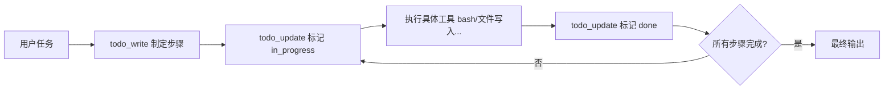

> "An agent without a plan drifts."（没有规划的 Agent 很容易跑偏。）

在上一小节中，Agent 已经掌握了直接调用底层工具的能力。但在面对复杂、跨多步骤的任务时，纯靠模型在上下文隐式思考极易发生**步骤遗漏或幻觉**。

为了让执行过程更可控，需要让 Agent 建立「计划-执行-复盘」机制：**执行前必须用工具制定步骤计划，每执行完一步立即更新状态**。将计划持久化到本地 JSON 文件中，便为 Agent 确立了独立、客观的“单一真实来源”（Single Source of Truth）。

完整源码参见：[03_todo_write.py](https://github.com/kongds1999/agent_from_scratch/blob/main/03_todo_write.py)。

---

## 规划系统的核心机制

在 [tools.py](https://github.com/kongds1999/agent_from_scratch/blob/main/tools.py) 中，我们为 Agent 注册了 3 个轻量的任务管理工具：

<CardGroup cols={3}>
  <Card title="todo_write" icon="pen-to-square">
    接收任务步骤列表，初始化带有状态（`pending`）的计划并保存至 `.agent_todo.json`。
  </Card>
  <Card title="todo_read" icon="book-open">
    从 JSON 读取并格式化输出当前任务列表与各项执行进度。
  </Card>
  <Card title="todo_update" icon="square-check">
    根据步骤索引更新特定任务的状态（如 `in_progress`、`done`）。
  </Card>
</CardGroup>



---

## 核心实现：精简代码

### 1. 任务工具定义（tools.py）

使用 `@function_tool` 装饰器，SDK 会自动从类型注解与 docstring 提取工具 Schema：

```python
TODO_FILE: str = ".agent_todo.json"

@function_tool
def run_todo_write(tasks: Annotated[list[str], "计划步骤描述列表"]) -> str:
    """初始化任务计划并覆盖保存到本地 JSON。"""
    data = [{"id": i, "task": t, "status": "pending"} for i, t in enumerate(tasks)]
    with open(TODO_FILE, "w", encoding="utf-8") as f:
        json.dump(data, f, indent=2)
    return f"Plan written ({len(tasks)} tasks)"

@function_tool
def run_todo_update(
    index: Annotated[int, "任务索引 ID (0-based)"], 
    status: Annotated[str, "新状态 ('in_progress' / 'done')"]
) -> str:
    """更新指定任务的执行状态。"""
    with open(TODO_FILE, "r", encoding="utf-8") as f:
        data = json.load(f)
    data[index]["status"] = status
    with open(TODO_FILE, "w", encoding="utf-8") as f:
        json.dump(data, f, indent=2)
    return f"Updated task {index} to: {status}"
```

完整工具实现与错误边界处理详见 [tools.py](https://github.com/TODO_PATH_HOLDER/tools.py)。

### 2. 系统策略约束（System Policy）

仅有工具还不够，必须在 `instructions` 中给 Agent 制定强约束的执行策略：

```python
SYSTEM: str = (
    f"You are a coding agent at {os.getcwd()}. "
    "Before working on any multi-step task, ALWAYS call todo_write first "
    "to write your plan. Then execute each step and call todo_update after each one. "
    "This ensures you stay on track and don't skip steps."
)
```

### 3. 流式执行与轮次控制（03_todo_write.py）

对于规划型多步任务，工具调用频次较高，SDK 默认的 10 轮限制（`DEFAULT_MAX_TURNS`）极易被触顶，需显式放宽 `max_turns` 并使用 `Runner.run_streamed` 流式输出：

```python
# 核心循环片段
result = Runner.run_streamed(
    agent, 
    input=current_input, 
    max_turns=50  # 避免多步骤任务触顶 MaxTurnsExceeded
)

try:
    async for event in result.stream_events():
        if event.type == "raw_response_event" and isinstance(event.data, ResponseTextDeltaEvent):
            print(event.data.delta, end="", flush=True)
except MaxTurnsExceeded as e:
    print(f"\n[!] {e} — 请增大 max_turns 或传 None")

# 必须更新多轮历史，保留本轮规划与工具调用上下文
conversation_history = result.to_input_list()
```

完整 REPL 交互入口与异常处理逻辑参见源码 [03_todo_write.py](https://github.com/TODO_PATH_HOLDER/03_todo_write.py)。

---

## 运行效果示例

```bash
❯ python 03_todo_write.py
s03: plan before execute | todo_write + todo_update
> 请检查目录下的 Python 文件，创建 tests/ 目录并编写 test_basic.py

# 1. 规划阶段
[todo_write] tasks=["列出 Python 文件", "创建 tests/ 目录", "编写 tests/test_basic.py"]
Plan written (3 tasks)

# 2. 执行与状态追踪阶段
[todo_update] index=0, status="in_progress"
[glob] *.py -> 01_agent_loop.py, 03_todo_write.py, tools.py
[todo_update] index=0, status="done"

[todo_update] index=1, status="in_progress"
[bash] mkdir -p tests
[todo_update] index=1, status="done"

[todo_update] index=2, status="in_progress"
[file_write] path="tests/test_basic.py" ...
[todo_update] index=2, status="done"

Final Answer:
已按计划完成全部 3 个步骤，成功创建 tests/ 目录并生成测试用例。
```

---

## 开发要点

<Tip>
**多步任务注意 `max_turns`**：OpenAI Agents SDK 默认的 `DEFAULT_MAX_TURNS` 通常为 10。多步任务涉及反复的计划与工具调用，很容易抛出 `MaxTurnsExceeded`，建议设为 50 或传 `None` 关闭。
</Tip>

<Warning>
**同步完整会话历史**：流式执行完毕后，切勿只存储最终文本，必须调用 `result.to_input_list()` 将包含 Tool Call 与工具返回结果的完整 Item 列表存入历史，以便后续交互保留上下文。
</Warning>

---

## 下一步

- [子 Agent 与任务转移（Handoffs）](./04_subagent)：将复杂子任务委派给专门的专家 Agent
