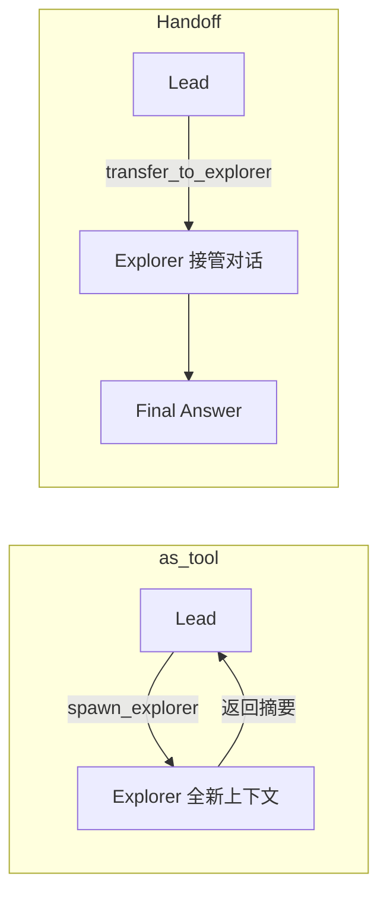

## 先看手搓版怎么做

在 [Agent Loop](./01_agent_loop) 里，我们自己写了一个 `run_bash` 工具。要实现「子 Agent」，最直觉的做法是再手搓一个 `spawn_subagent`：模型调用它，函数里新建 client、开一段**全新对话**，跑完把最终文本返回给主 Agent。

```python
def run_subagent(prompt: str) -> str:
    sub_messages = [{"role": "user", "content": prompt}]   # 全新上下文
    while True:
        response = client.messages.create(system=SUBAGENT_SYSTEM,
                                          messages=sub_messages, tools=EXTENDED_TOOLS)
        sub_messages.append({"role": "assistant", "content": response.content})
        if response.stop_reason != "tool_use":
            break
        sub_messages.append({"role": "user",
                             "content": dispatch_tools(response.content, EXTENDED_DISPATCH)})
    return "".join(b.text for b in sub_messages[-1]["content"] if hasattr(b, "text"))
```

这段能跑，但**循环、上下文隔离、结果拼接全要自己维护**。OpenAI Agents SDK 提供了两种更省心的方式。

## 第一种：Agent.as\_tool

`as_tool` 把一个 Agent 包装成普通工具，供其他 Agent 调用——子 Agent 拿到全新上下文，执行完把结果以工具返回值的形式交回给父 Agent。

```python
from agents import Agent

explorer_agent = Agent(
    name="Explorer",
    instructions=f"You are an exploration subagent at {os.getcwd()}. "
                  "Investigate thoroughly. Summarize your result clearly at the end.",
    tools=AGENT_TOOLS,
)

spawn_explorer = explorer_agent.as_tool(
    tool_name="spawn_explorer",
    tool_description="Spawn an explorer in a fresh context; it returns a summary.",
)

lead = Agent(
    name="Lead",
    instructions=f"You are the lead coding agent at {os.getcwd()}. "
                  "For isolated or noisy subtasks, delegate via spawn_explorer.",
    tools=[*AGENT_TOOLS, spawn_explorer],
)
```

不需要手写循环，也不用拼接返回值——定义子 Agent，`as_tool` 包一下，挂到 `tools` 里就行。

<Note>

`as_tool` 本质是普通工具调用：主 Agent 需要**把任务背景写进调用参数**，等子 Agent 返回摘要后在当前上下文里继续。控制权始终在父 Agent 手里。

</Note>

## 第二种：Handoffs（任务转移）

Handoffs 的思路不同：不是「派活等结果」，而是把整个对话直接**转交**给子 Agent 接管。SDK 会自动把每个目标 Agent 暴露成名为 `transfer_to_<agent_name>` 的工具：

```python
from agents import Agent, handoff

explorer_agent = Agent(
    name="Explorer",
    handoff_description=(
        "适合探索型子任务：通读代码库、搜索文件、理解实现细节。"
        "会产生大量中间输出，交给它可以把噪声隔离在 Lead 之外。"
    ),
    instructions=(
        f"You are an exploration subagent at {os.getcwd()}. "
        "Investigate thoroughly, then give a concise structured summary."
    ),
    tools=AGENT_TOOLS,
)

lead = Agent(
    name="Lead",
    handoffs=[explorer_agent, handoff(coder_agent)],  # 两种写法等价
)
```

<Note>

Handoff 对 LLM 而言也是工具调用，工具名是 `transfer_to_explorer`。但接手的 Agent **不会把结果还回来**，而是直接继承并继续执行——这是它和 `as_tool` 最根本的区别。

</Note>

## 两种方式对比



|               | Handoff（任务转移）        | `Agent.as_tool()`               |
| ------------- | -------------------- | ------------------------------- |
| 子 Agent 看到的历史 | 默认能看到完整对话            | 只有传入的输入，**全新上下文**               |
| 控制权           | 子 Agent **接管**对话，不交回 | 以工具结果形式**返回**给父 Agent            |
| 适合场景          | 按领域切换专家、分诊路由         | 派活、探索、汇总（手搓版 `spawn_subagent` 的直接替代） |

## 用工厂函数封装 Handoff

手搓版 `spawn_subagent` 里有三块东西：**工具 schema**、**分发逻辑**、**子 Agent 执行**。SDK 一一对应：

| 手搓版                                       | SDK 版                                          |
| ----------------------------------------- | ---------------------------------------------- |
| `input_schema={"prompt": str}`            | `input_type=Delegation`（Pydantic 模型）           |
| 工具名 + description                         | `handoffs=[agent]` + `agent.handoff_description` |
| `lambda inp: run_subagent(inp["prompt"])` | `on_handoff(ctx, data)` 回调                     |
| 手写的 `client.messages.create` 循环           | `Runner.run_streamed(...)` SDK 自动跑             |
| `sub_messages = [...]` 新建上下文              | `input_filter=...` 过滤传给子 Agent 的历史            |

把「目标 Agent + 结构化输入 + 日志 + 历史过滤」打包成一个工厂函数：

```python
from pydantic import BaseModel, Field
from agents import handoff
from agents.extensions.handoff_prompt import prompt_with_handoff_instructions

class Delegation(BaseModel):
    task: str = Field(description="交给子 agent 的具体子任务描述")

def make_handoff(target: Agent):
    async def on_handoff(ctx, data: Delegation):
        print(f"[subagent] delegating to {target.name}: {data.task}")

    return handoff(
        target,
        on_handoff=on_handoff,
        input_type=Delegation,        # 工具参数 schema，SDK 自动校验模型输出的 JSON
        input_filter=strip_tool_noise,
    )

lead = Agent(
    name="Lead",
    instructions=prompt_with_handoff_instructions(
        f"You are the lead coding agent at {os.getcwd()}. "
        "For complex, isolated, or noisy subtasks, delegate to the right specialist."
    ),
    handoffs=[make_handoff(explorer_agent), make_handoff(coder_agent), make_handoff(reviewer_agent)],
)
```

<Warning>

`input_type` 描述的是**任务转移工具调用的参数**，它不会替换下一个 Agent 的主输入，也不能用来选择其他目标。`handoff()` 永远把控制权交给你传入的那个 `agent`。

</Warning>

`prompt_with_handoff_instructions()` 会在系统 prompt 里自动追加一段说明，告诉模型「这是一个多 Agent 系统，转移在后台完成，不要在对话里提及」。

## input\_filter：子 Agent 到底看到什么

这是最容易觉得「玄学」的地方。`input_filter` 收到一个 `HandoffInputData`，返回什么子 Agent 就只看到什么：

```python
@dataclass
class HandoffInputData:
    input_history: tuple[...]       # Runner.run() 开始前的历史
    pre_handoff_items: tuple[...]   # 本次 run 内、handoff 之前生成的 item
    new_items: tuple[...]           # 本轮：handoff 调用 + handoff 输出
```

### 过滤前后对比

场景：第 1 轮 Lead 用了 `bash`（产生工具噪声），第 2 轮 handoff 给 Explorer：

```text
过滤前 input_history:  user / reasoning / function_call(run_bash) / function_call_output / message / user
过滤后 input_history:  user / message(Lead 的文字回答) / user

过滤前 new_items:      ReasoningItem / HandoffCallItem / HandoffOutputItem
过滤后 new_items:      HandoffCallItem / HandoffOutputItem
```

Explorer **能看到**：用户的话、Lead 的文字回答、`transfer_to_explorer` 的参数和输出。**看不到**：reasoning 过程、`run_bash` 的调用细节与原始输出。

### 实现与两个易错点

```python
from agents.handoffs import HandoffInputData
from agents.items import ToolCallItem, ToolCallOutputItem, ReasoningItem

_TOOL_NOISE = (ToolCallItem, ToolCallOutputItem, ReasoningItem)
_NOISY_RAW_TYPES = {"function_call", "function_call_output", "reasoning"}

def strip_tool_noise(data: HandoffInputData) -> HandoffInputData:
    def keep(items):
        return tuple(i for i in items if not isinstance(i, _TOOL_NOISE))

    history = data.input_history
    if isinstance(history, tuple):
        history = tuple(i for i in history if i.get("type") not in _NOISY_RAW_TYPES)

    return data.clone(
        input_history=history,
        pre_handoff_items=keep(data.pre_handoff_items),
        new_items=keep(data.new_items),
    )
```

<Tip>

两个字段要**分别过滤**：`input_history` 是原始 dict（按 `type` 字段过滤），`pre_handoff_items` / `new_items` 是 SDK 的 RunItem 对象（按类过滤）。只处理其中一个，工具噪声就会漏过去。

</Tip>

<Tip>

为什么保留 `HandoffCallItem` / `HandoffOutputItem`？因为它们是独立的类，不属于 `ToolCallItem` / `ToolCallOutputItem`。SDK 自带的 `remove_all_tools` 过滤器更激进，会连 handoff 自身的 item 一起删掉，导致流式 `handoff_occured` 事件不再触发。

</Tip>

### 和手搓版的差异

手搓版 `sub_messages = [{"role": "user", "content": prompt}]` 是**完全清空**；`strip_tool_noise` 是**降噪式隔离**——保留对话文字，只丢工具噪声：

|            | 手搓 `spawn_subagent` | 当前 handoff |
| ---------- | ------------------- | ---------- |
| 用户历史       | 全部丢掉                | 保留         |
| 工具调用 / 输出  | 丢掉                  | 丢掉         |
| reasoning  | 丢掉                  | 丢掉         |
| handoff 记录 | 无                   | 保留         |

想更接近「全新上下文」，可以只保留最后一条用户消息：

```python
def only_last_user(data):
    last_user = [i for i in data.input_history
                 if isinstance(i, dict) and i.get("role") == "user"][-1:]
    return data.clone(input_history=tuple(last_user), pre_handoff_items=())
```

## 跑起来是什么样

主循环用 `Runner.run_streamed`，顺便把 handoff 过程可视化出来：

```python
result = Runner.run_streamed(lead_agent, input=current_input, max_turns=50)

async for event in result.stream_events():
    # 文本增量：实时打印最终回答
    if event.type == "raw_response_event" and isinstance(event.data, ResponseTextDeltaEvent):
        print(event.data.delta, end="", flush=True)

    # Handoff 事件：谁把对话移交给了谁
    elif event.type == "run_item_stream_event" and event.name == "handoff_occured":
        print(f"[handoff] {event.item.source_agent.name} -> {event.item.target_agent.name}")

    # Agent 切换：转移后由新 Agent 接管
    elif event.type == "agent_updated_stream_event":
        print(f"[agent] now running: {event.new_agent.name}")

conversation_history = result.to_input_list()
```

终端里一次 handoff 长这样：

```text
> 帮我看看 tools.py 里都有哪些工具

  [handoff] Lead -> Explorer
  [agent] now running: Explorer

Final Answer:
tools.py 里一共注册了 6 个工具……
[last agent] Explorer
```

<Tip>

注意最后的 `[last agent] Explorer`：handoff 之后控制权不会还回来，`result.last_agent` 就是 Explorer。用 `as_tool` 的话，`last_agent` 始终是 Lead——这是两者最直观的区别。

</Tip>

## 官方重要说明

<Warning>

**任务是单向接管，不会自动回来。** 转移后由子 Agent 接管对话，它的输出就是最终输出。需要「派活 + 汇总」请改用 `as_tool`。

</Warning>

<Warning>

**`is_enabled` 无法对参数做授权。** 它在 SDK 准备可用 handoff 时求值，此时模型还没返回参数。若授权依赖解析后的字段，请在 `on_handoff` 开头检查，失败就抛异常。

</Warning>

<Info>

- 输入 / 输出安全防护仅作用于链中**第一个**（输入）和生成最终输出的（输出）Agent；要检查每一次工具调用，请用工具安全防护。
- Handoff 始终在同一次 `run` 内完成。
- 服务器托管会话（`conversation_id` 等）**不支持** `input_filter`。
- 嵌套 handoff 历史（`nest_handoff_history`）默认关闭，启用后历史会被压缩成摘要片段。

</Info>

## 下一步

- 用 `input_type` 给 handoff 带上 `reason` / `priority` 等元数据并写审计日志
- 用 `RunHooks.on_handoff` 统一监听整条链上的转移事件
- 结合 Sessions 让跨多轮对话的 handoff 历史可持久化

## 参考资料

- [OpenAI Agents SDK — Handoffs 官方文档](https://openai.github.io/openai-agents-python/zh/handoffs/)
