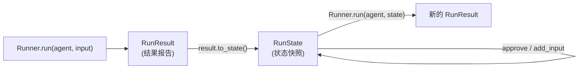

## 为什么需要检查点

简单场景下，每次把聊天记录拼接起来发给模型就够了。但当 Agent 执行复杂任务时——比如连续调用了 20 个工具，中途遇到网络断连、进程崩溃，或者某个操作需要人来确认——你很难手动还原出"执行到了第几步、上下文是什么"这样的完整状态，通常只能从头重跑。

检查点机制解决两个问题：

1. **让 Agent 暂停等待人工确认**：例如 Agent 准备调用一个扣款接口，你希望它先停下来，等你确认后再继续执行。
2. **持久化保存执行进度**：把 Agent 当前的状态存到数据库，即使过了几天或换了一台服务器，也能从上次中断的位置继续。

<Note>
例如：Agent 需要依次调用 30 个工具完成一个任务，在第 20 步时断网了。没有检查点只能从头开始；有了检查点，可以直接从第 20 步恢复。
</Note>

---

## 核心概念：RunResult 与 RunState

调用 Agent 的两种方式：

```python
# 同步调用
result = Runner.run_sync(agent, "Write a haiku about recursion in programming.")

# 异步调用
result = await Runner.run(agent, "Write a haiku about recursion in programming.")
```

<Tip>
`run_sync` 是同步包装器，适合普通脚本。如果代码已经运行在异步环境中（如 FastAPI、Jupyter Notebook），调用 `run_sync` 会抛出 `RuntimeError`，此时应使用 `await Runner.run(...)`。
</Tip>

两种方式都返回 `RunResult`——可以理解为本次运行的"结果报告"，包含模型的回答、Token 用量等信息，但它是只读的，不能用来恢复执行。

要保存和恢复执行进度，需要从 `RunResult` 中提取 `RunState`：

```python
checkpoint = result.to_state()
```

`RunState` 是 Agent 执行状态的完整快照——记录了当前执行到哪一步、对话历史、工具调用情况、以及哪些操作还在等待确认。你可以对它进行操作（批准、驳回、追加指令），然后传回 `Runner.run()` 恢复执行。

两者对比：

| | `RunResult` | `RunState` |
| :--- | :--- | :--- |
| 作用 | 本次运行的结果报告（回答、Token 用量、事件记录） | 执行状态快照（跑到哪了、什么还没完成） |
| 可变性 | 只读 | 可修改（`approve` / `reject` / `add_input`） |
| 持久化 | 含运行时临时引用，不适合序列化 | 支持 JSON 序列化（`to_json` / `from_json`），可存入数据库 |
| 流转方向 | `Runner.run(...)` 的返回值 | `Runner.run(...)` 的输入参数 |

### 生命周期



---

## 工作流程

检查点的使用分三步：

1. **捕获状态**：调用 `result.to_state()` 将 Agent 当前的内部状态冻结为 `RunState`，包括对话历史、工具调用记录、待确认的中断请求等。
2. **持久化存储**（可选）：通过 `to_json()` 将 `RunState` 转为 JSON 字符串，由你自行存入数据库。之后用 `RunState.from_json()` 还原。
3. **恢复执行**：将 `RunState` 传入 `Runner.run(agent, checkpoint_state)`，SDK 自动跳过已完成的步骤，从中断处继续。

<Warning>
SDK 本身不提供存储功能。`to_json()` 只负责将状态序列化为 JSON 字符串，存储到哪里、怎么管理，需要你自己实现。
</Warning>

一个典型的持久化流程：

```python
from agents.run import RunState

# 保存：序列化后存入数据库
checkpoint = result.to_state()
json_str = checkpoint.to_json()
db.save(run_id="task-001", state=json_str)  # 你自己的数据库操作

# 恢复：从数据库读取后反序列化
json_str = db.load(run_id="task-001")
restored_state = RunState.from_json(json_str)
resumed_run = await Runner.run(agent, restored_state)
```

---

## 常见问题

### `add_input` 报错 "Cannot add input to a terminal RunState"

这个错误表示 Agent 已经正常结束了运行，不能再向一个已完成的状态追加输入。

`add_input()` 只在 Agent 处于**暂停等待状态**时才能调用。要让 Agent 在特定步骤暂停，需要给工具设置 `needs_approval=True`：

```python
@function_tool(needs_approval=True)
def send_email(to: str, content: str) -> str:
    """发送邮件"""
    ...
```

当 Agent 尝试调用这个工具时，执行会暂停并等待审批，此时才能通过 `add_input()` 追加指令。

### 暂停时 `final_output` 为 `None`

`final_output` 只在任务完全结束时才有值。Agent 因工具审批暂停时，任务尚未结束，因此为 `None`。

暂停前模型生成的文本保存在 `result.new_items` 中，可以这样提取：

```python
from agents.items import ItemHelpers, MessageOutputItem

first_step_text = next(
    (ItemHelpers.extract_text(item.raw_item) for item in first_run.new_items if isinstance(item, MessageOutputItem)),
    None
)
```

---

## 完整示例

以下代码演示了完整流程：

1. Agent 输出第一阶段结果，调用带审批的工具后暂停
2. 将暂停状态保存为检查点
3. 人工审批并输入下一步指令
4. 从检查点恢复执行

```python
import os
import asyncio
from dotenv import load_dotenv
from agents import Agent, Runner, set_tracing_disabled, function_tool
from agents.items import ItemHelpers, MessageOutputItem
from agents.extensions.models.litellm_model import LitellmModel

load_dotenv()
set_tracing_disabled(True)

custom_model = LitellmModel(
    model="gpt-5.6-terra",
    base_url=os.getenv("LITELLM_PROXY_API_BASE", ""),
    api_key=os.getenv("LITELLM_PROXY_API_KEY", "")
)

# needs_approval=True 使 Agent 在调用此工具时暂停等待审批
@function_tool(needs_approval=True)
def wait_for_human_instruction(stage_summary: str) -> str:
    """阶段任务完成后调用此工具，暂停等待人类的下一步指令。"""
    return f"人类已确认（阶段：{stage_summary}）"

agent = Agent(
    name="Researcher",
    instructions="你是一个研究助手。首先列出量子计算的三个核心概念并简要概述。列出完毕后，你必须调用 wait_for_human_instruction 工具等待人类指令。",
    model=custom_model,
    tools=[wait_for_human_instruction]
)

async def main():
    # 第一阶段：运行 Agent，遇到审批工具时自动暂停
    print("--- 开始运行 ---")
    first_run = await Runner.run(agent, "请列出量子计算的三个核心概念，然后停下来等我指令。")

    # 暂停前的模型输出保存在 new_items 中
    first_step_text = next(
        (ItemHelpers.extract_text(item.raw_item) for item in first_run.new_items if isinstance(item, MessageOutputItem)),
        None
    )
    print(f"\nAgent 回答:\n{first_step_text}")
    print(f"是否触发暂停: {bool(first_run.interruptions)}")

    # 保存检查点
    checkpoint = first_run.to_state()

    # 可选：序列化为 JSON 存入数据库
    # json_str = checkpoint.to_json()

    # 人工审核
    print("\n--- 人工审核 ---")
    await asyncio.sleep(1)

    # 批准暂停的工具调用
    if first_run.interruptions:
        checkpoint.approve(first_run.interruptions[0])

    # 追加人工指令
    human_input = input("请输入下一步指令 > ")
    checkpoint.add_input(human_input)

    # 第二阶段：从检查点恢复执行
    print("\n--- 恢复执行 ---")
    resumed_run = await Runner.run(agent, checkpoint)
    print(f"\n恢复后回答:\n{resumed_run.final_output}")

    # Token 用量按阶段独立统计
    print(f"\n第一阶段 Token: {first_run.context_wrapper.usage.total_tokens}")
    print(f"第二阶段 Token: {resumed_run.context_wrapper.usage.total_tokens}")

if __name__ == "__main__":
    asyncio.run(main())
```

### 运行效果

```text
--- 开始运行 ---

Agent 回答:
量子计算的三个核心概念：
1. **量子比特（Qubit）**：不同于只能取 0 或 1 的经典比特，量子比特可以处于 0 与 1 的线性叠加状态。
2. **量子叠加（Superposition）**：量子系统可同时以多种可能状态存在，测量时坍缩为确定结果。
3. **量子纠缠（Entanglement）**：多个量子比特能够形成不可分割的强关联联合状态。

是否触发暂停: True

--- 人工审核 ---
请输入下一步指令 > 我已确认，请针对叠加态详细解释。

--- 恢复执行 ---

恢复后回答:
### 量子叠加态（Superposition）详解
量子叠加态是量子力学中最核心的概念之一...

第一阶段 Token: 489
第二阶段 Token: 1714
```

---

## Checkpoint 与 Session 的选择

两者容易混淆，核心区别是：**Session 管理对话历史，Checkpoint 管理执行进度**。

| 场景 | 推荐方案 | 说明 |
| :--- | :--- | :--- |
| 普通多轮对话 | Session（如 `SQLiteSession`） | 每轮对话正常结束，只需维护聊天记录 |
| 执行中途需要人工确认 | Checkpoint（`RunState`） | 任务尚未结束，需要暂停、审批、再继续 |
| 长任务防中断 | Checkpoint（`RunState`） | 在关键步骤保存状态，故障后从最近的检查点恢复 |
| 需要驳回 Agent 的下一步操作 | Checkpoint（`RunState`） | 通过 `state.reject(item, reason="...")` 让模型重新规划 |

---

## prompt 模板

如果你正在使用 Cursor、Claude Code、Windsurf 等 Coding Agent 构建 Agent，可以直接复制以下提示词模板发给它，快速为你的项目增加基于 OpenAI Agents SDK 的检查点（Checkpoint）、中断、审核与恢复流程：

<Tip>
此提示词特别约束了持久化行为：Coding Agent **不会擅自硬编码数据库或文件存储**，而是先为你梳理接入逻辑，并与你确认具体的持久化介质需求后再进行落地。
</Tip>

````markdown
你是一位精通 OpenAI Agents SDK（agents-sdk）的高级研发工程师。
请协助我为当前正在构建的 Agent 接入基于 RunState 的检查点（Checkpoint）机制，实现执行中断、人工审核与断点恢复。

### 核心任务与改造规范

1. **识别与设置中断点（Interruption）**：
   - 梳理现有工具中涉及关键/高风险操作（如外部数据修改、发信、扣费交易）或需要分阶段等待人类反馈的工具。
   - 使用 `@function_tool(needs_approval=True)` 标记这些工具，使其触发时自动挂起执行并产生中断。

2. **状态捕获与阶段输出提取（RunState）**：
   - 统一采用异步调用：`result = await Runner.run(agent, ...)`。
   - 当检测到触发中断（`bool(result.interruptions) == True`）时，调用 `checkpoint = result.to_state()` 冻结当前执行状态。
   - 注意：暂停时 `result.final_output` 为 `None`，请使用 `ItemHelpers` 从 `result.new_items` 中提取暂停前模型生成的阶段性输出，以便展示给用户。

3. **审核与恢复机制（Approval & Resume）**：
   - 实现审核交互逻辑，支持：
     - 批准执行：`checkpoint.approve(item)`
     - 驳回并说明原因：`checkpoint.reject(item, reason="...")`
     - 追加输入指令：`checkpoint.add_input(user_input)`（注意仅在暂停且非终止状态调用）
   - 审核完成后，将更新后的 `checkpoint`（`RunState`）传入 `await Runner.run(agent, checkpoint)` 从中断处继续执行。

4. **序列化与持久化指导（重要：仅提供指导，不要擅自实现存储）**：
   - OpenAI Agents SDK 支持通过 `checkpoint.to_json()` 进行 JSON 序列化，以及使用 `RunState.from_json(json_str)` 反序列化还原状态。
   - **请不要直接引入或硬编码任何具体的存储方案（如 SQLite、PostgreSQL、Redis、本地文件等）**。
   - 请在代码中仅预留存取抽象接口或提供架构建议，并主动与我确认：
     1. 当前项目是否需要跨进程/跨服务的持久化能力，还是仅在内存生命周期内完成暂停与恢复？
     2. 如果需要持久化，你倾向于使用什么存储介质（如 Redis、关系型数据库、还是本地文件）？
     待我明确需求后，再帮我编写具体的持久化读写逻辑。

请先分析我当前的代码结构，列出你计划标记审批的工具和改造步骤，在征得我确认后再进行代码修改。
````

---

## 小结

Agents SDK 的检查点不只是保存聊天记录，而是保存 Agent 的完整运行状态：执行到了哪一步、调用了哪些工具、还有哪些操作在等待确认。

关键要点：`RunResult` 是运行结果的只读报告；`RunState` 是可操作的状态快照，支持暂停、持久化和恢复。要让 Agent 在关键步骤暂停等待人工确认，给工具加上 `needs_approval=True` 即可。
