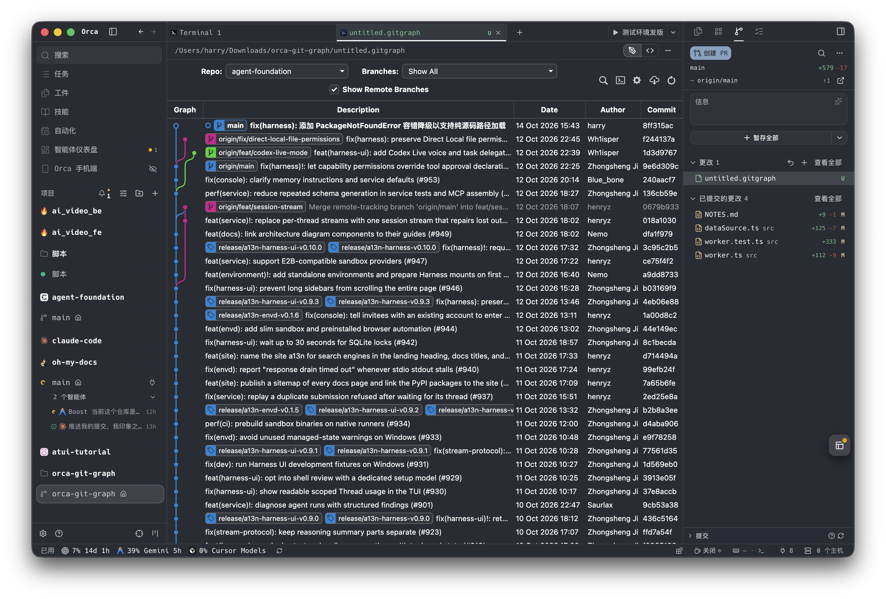

从 VS Code 转到 Orca 之后，最念念不忘的神器之一就是 **Git Graph**。

平时分支切得多、还要在多个 Worktree 和 Cherry-pick 节点之间来回跳转，纯靠终端敲 `git log --graph --oneline` 很容易眼花；而在侧边栏塞一个提交树又窄得捉襟见肘，列信息挤成一团。

于是周末抽空折腾了一番，把经典扩展 [mhutchie/vscode-git-graph](https://github.com/mhutchie/vscode-git-graph) 完整移植到了 Orca 中，并改造成了 **全宽编辑器标签页（Custom Editor）** 插件。

<CardGroup cols={2}>
  <Card title="GitHub 个人私有仓库" icon="github" href="https://github.com/kongds1999/orca-git-graph">
    kongds1999 / orca-git-graph（受原许可证限制仅供个人本地使用）
  </Card>
  <Card title="技术复盘长文" icon="book-open" href="/posts/2026-11/orca-git-graph">
    阅读完整的架构复盘与 Git 逻辑避坑指南
  </Card>
</CardGroup>

> [!NOTE]
> **关于许可证说明**：原版扩展采用非商用/禁止分发衍生作品的许可证，因此本项目仅供个人在本地开发环境折腾使用，不公开发行上架，也不做商业用途。

---

## 插件界面一览

告别了窄窄的侧边栏，直接在编辑区全宽标签页内打开提交树，分支树分支流向、标签、Commit Message 和详情面板一览无余：

  

---

## 折腾过程中的几个爽点

<AccordionGroup>
  <Accordion title="1. 从侧边栏到全宽编辑器标签页的质变" defaultOpen>
    起初尝试过做成 Orca 侧边栏 Panel，但侧边栏宽度通常只有 300~500px，Description、Date、Author、Commit 四列挤在一块极其局促。
    
    果断推翻窄屏适配，改为声明 `contributes.customEditors`（绑定 `.gitgraph` 后缀）。通过新建文件或快捷键直接以全宽标签页展开，支持自由拖动分屏，体验顺滑了数倍。
  </Accordion>

  <Accordion title="2. Trusted Worker 独立进程 + 零外部依赖" defaultOpen>
    底层基于 Orca 的 `trusted-worker` 独立 Node 进程模型，前端通过 `window.acquireVsCodeApi()` shim 与 Worker 消息通信。
    
    所有 Git 命令均通过 Node 原生 `child_process.execFile` 数组化参数调用系统 git，零 npm 外部依赖，既快又安全，不用担心 shell 注入。
  </Accordion>

  <Accordion title="3. 踩坑填坑：把 Git 写操作打磨严密" defaultOpen>
    本以为直接搬过来就能跑，实测发现藏着大量隐蔽的边界坑：
    - `diff-index HEAD` 没加 `--cached`，导致未暂存修改误触发 squash commit 报错；
    - `editRemote` 需要严格按照 rename -> set-url -> push-url 时序状态机执行；
    - `git config --unset` 在键不存在时会返回 exit code 5，需要容错处理避免弹窗报错；
    - GNU gettext 多语言环境下正则匹配报错失效，需要强制注入 `LC_ALL: 'en_US.UTF-8'` 隔离；
    - 贮藏选择符格式把 `%gD` 修正为 `%gd`，UI 徽章恢复规范的 `@{0}` 显示。
  </Accordion>
</AccordionGroup>

---

## 体验与小结

现在每天在 Orca 里切分支、比对提交、Cherry-pick 补丁、或者挑着几条 Commit squash 合并，在图形化界面上点几下就能搞定，心智负担小了很多。

对具体架构设计和踩坑细节感兴趣的话，可以戳这里看这篇更完整的工程复盘：👉 [《将 Git Graph 移植到 Orca ADE》](/posts/2026-11/orca-git-graph)。
