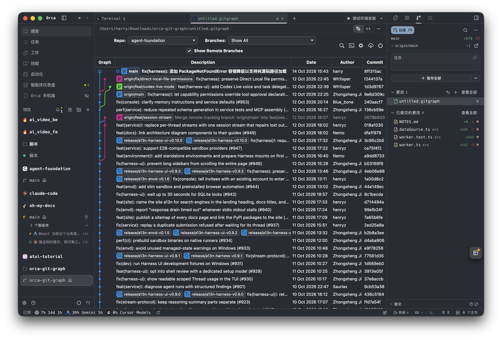

在多分支并行开发、频繁使用 Git Worktree 和交互式变基（Interactive Rebase）的工作流中，清晰的可视化提交树往往能大幅降低心智负担。

VS Code 生态中，Michael Hutchison 开源的 **[vscode-git-graph](https://github.com/mhutchie/vscode-git-graph)** 无疑是最经典的提交图扩展之一。然而迁至 Orca 之后，我发现官方生态中缺乏一个趁手的沉浸式提交图工具。

于是我动手完成了一次完整的移植实践：将原版编译产物复用并深度改造为 Orca 的 **Trusted Worker 插件**，将其从拥挤的侧边栏重构为 **全宽编辑器标签页（Custom Editor）**，并对多处深层 Git 操作逻辑进行了严格的加固与边界修复。

本文将复盘这一移植过程中的架构设计、交互演进以及一系列硬核的 Git 操作避坑经验。

---

## 1. 核心架构设计：从 VS Code Webview 到 Orca Trusted Worker

在 VS Code 架构中，扩展运行在 Extension Host 进程中，通过 `acquireVsCodeApi()` 与 Webview 面板进行 `postMessage` 双向通信。

而在 Orca 中，我们采用了更安全、解耦的进程架构：

```text
┌─────────────────────────────────────────────────────────────┐
│                 Orca Custom Editor Frame                    │
│   (editor/index.html + out.min.js + out.min.css)            │
│       - window.acquireVsCodeApi() shim                      │
│       - window.orca.document.session 保持无脏文档提示        │
└──────────────────────────────┬──────────────────────────────┘
                               │
                orca.plugin.request('msg', payload)
                orca.plugin.on('msg', callback)
                               │
                               ▼
┌─────────────────────────────────────────────────────────────┐
│                 Orca Trusted Worker Process                 │
│                      (src/worker.ts)                        │
│       - orca.panels.handle('msg') 分发业务消息               │
│       - 状态记忆持久化 (orca.storage)                        │
│       - 工作区关联与多 Worktree 仓库精准解析                │
└──────────────────────────────┬──────────────────────────────┘
                               │
                        TypeScript 函数调用
                               │
                               ▼
┌─────────────────────────────────────────────────────────────┐
│                   DataSource (src/dataSource.ts)            │
│       - child_process.execFile 严格数组化调用系统 Git        │
│       - 零第三方 npm 依赖，内置严格的 RefName 参数注入防范   │
│       - 统一注入 en_US.UTF-8 环境变量隔绝语言干扰           │
└─────────────────────────────────────────────────────────────┘
```

### 1.1 Webview 协议 Shim
为了最大程度复用原版前端经过充分实战检验的渲染树与交互逻辑，我们在 `editor/index.html` 中注入了原版 API 的兼容层：
- 实现 `window.acquireVsCodeApi()`：模拟 `postMessage`，将其映射为 `orca.plugin.request('msg', payload)`；
- 事件回传通道：Worker 处理完 Git 任务后，通过 `window.dispatchEvent(new MessageEvent('message', { data }))` 灌入前端，保证原版编译产物无需任何逆向篡改即可平稳运行。

### 1.2 零外部依赖的数据层
与许多依赖庞大第三方 Git 库的方案不同，我们基于 Node 原生 `child_process.execFile` 构建了 `DataSource`：
- **安全性**：全量采用**参数数组化**传参，杜绝任何 Shell 字符串拼接导致的命令注入风险；
- **轻量可靠**：零 `node_modules` 外部依赖，安装包体积仅包含原版前端编译产物与纯 TypeScript 编译后的 JS 文件。

---

## 2. 交互形态的跃迁：为什么放弃侧边栏，拥抱全宽 Custom Editor？

在移植的第一阶段，我曾尝试将其做成 Orca 侧边栏的辅助面板（Sidebar Panel）。但在实际使用中，侧边栏方案暴露出了致命的局限性：

1. **窄屏信息吞噬**：侧边栏宽度通常只有 300~500px。Git Graph 的一行包含分支拓扑图、Commit Message、Date、Author、Commit Hash 等多列信息，在窄屏下要么互相重叠，要么触发繁琐的横向滚动。
2. **详情面板（CDV）冲突**：点击某一次提交查看文件改动时，侧边栏不得不采用垂直堆叠展示，视觉割裂严重。

<div className="w-full my-6 rounded-xl overflow-hidden border border-zinc-200 dark:border-zinc-800 shadow-md">
  
</div>

### 拥抱 Custom Editor（`.gitgraph`）
我们果断推翻了侧边栏响应式方案，改为声明 `contributes.customEditors`，并绑定 `.gitgraph` 文件后缀：
- **全局开阔视野**：作为独立的编辑器标签页打开，享有工作区中间的全部宽度，支持自由拆分、拖拽与分屏比对；
- **生命周期静默管理**：通过 `window.orca.document.session` 显式维护会话状态，保证用户在关闭或切换标签页时不会触发烦人的“未保存更改”确认对话框。

---

## 3. Git 操作逻辑深水区的避坑与修复

虽然提交树的读取解析相对直观，但在将“分支检出、变基、合并、用户设置、贮藏与远程管理”等一系列写操作落地时，遇到了若干极度隐蔽的边界坑。

### 3.1 `diff-index` 的暂存区误判陷阱
- **问题现象**：在进行 Squash Merge 或 Pull 时，如果工作区有未暂存的修改，Git 会莫名其妙报错 `no changes added to commit`。
- **根本原因**：原代码使用 `git diff-index HEAD` 判断是否存在暂存变动。然而没有 `--cached` 时，`diff-index` 比对的是**工作区文件与 HEAD**！因此只要工作区有任何脏文件，就会被误判为“有暂存变更”，进而强行触发 `git commit -m`。
- **解法**：必须显式传入 `['diff-index', '--cached', 'HEAD']`。同时，针对尚未完成首次初始提交的空仓库（Unborn branch），引入 `git diff --cached --name-only` 兜底，并完美兼容 SHA-1 与 SHA-256 存储格式。

### 3.2 远程编辑（`editRemote`）的时序状态机
编辑远程仓库时，涉及远端名称修改、Fetch URL 变更以及 Push URL 的增删改。操作必须遵循严格的时序：
```text
1. 校验 nameOld 与 nameNew 是否合法
2. 若 nameOld !== nameNew:
   先执行 git remote rename <nameOld> <nameNew>
   后续所有命令必须重定向作用在 nameNew 上
3. 若 Fetch URL 变更:
   调用 git remote set-url <name> <urlNew>
4. 若 Push URL 变更:
   根据新旧状态分别调用 --push --add、替换或 --push --delete
```
任何乱序或漏传都会导致 Git 远端配置进入破损状态。

### 3.3 `git config --unset` 退出码 5 的容错处理
- **问题现象**：用户在界面中删除未配置过的本地签名时，前端会弹出红色的异常报错浮层。
- **根本原因**：当目标键原本就不存在于配置中时，`git config --unset` 会以退出码 `5` 退出。这本属于“已达到删除目的”的幂等状态，若直接当作进程运行异常上报，会导致前端判定操作失败。
- **解法**：捕获退出码 `5` 并直接视为成功（`null`），同时返回严格对齐前端协议的 `[null, ...]` 数组，确保前端成功回调 `requestLoadConfig()` 重新加载配置。

### 3.4 GNU gettext 多语言环境下的致命正则穿透
- **问题现象**：在系统语言设为中文的机器上，删除远程已被清理的分支时，本地 tracking branch 无法被自动 prune。
- **根本原因**：代码中通过 `/remote ref does not exist/i` 正则识别错误信息。在中文环境下，Git stderr 输出的是“远程引用不存在”，正则匹配瞬间失效。
- **解法**：在所有 Git 子进程的执行环境中，强制注入环境变量：
  ```typescript
  const GIT_ENV = {
    ...process.env,
    LC_ALL: 'en_US.UTF-8',
    LANG: 'en_US.UTF-8',
    LANGUAGE: 'en_US.UTF-8',
  };
  ```
  彻底杜绝宿主机多语言导致的输出解析飘移。

### 3.5 视图状态（Column Widths / ViewState）的持久化
用户在界面中拖动调整列宽、调整详情面板高度、展开/折叠分支、过滤指定远端时，前端会持续派发 `setRepoState` 和 `setWorkspaceViewState`。

我们在 Worker 端将这些状态实时写入 Orca 的 `orca.storage`。这样，在下次重新打开标签页或热重载插件时，所有个性化的视图偏好均能无缝还原。

---

## 4. 总结与体会

将一个成熟但与当前宿主平台技术栈不一致的经典工具移植到新平台中，核心在于两点：

1. **协议层最大程度兼容，宿主层充分利用新特性**：复用经过百万用户检验的原版前端，而在外围利用 Orca 现代化的 Trusted Worker 与 Custom Editor 提供更优异的全宽视觉体验。
2. **敬畏系统调用的边界**：底层的 Git 命令看似简单，但在暂存区空状态、不同文件系统哈希格式、子进程退出码语义与语言环境变量等方面隐藏着无数陷阱。完整的单元测试套件和临时仓库（tmpdir）自动化测试是保证工具可靠性的唯一基石。

现在，这款定制的 Git Graph 已经成为了我日常在 Orca 中不可或缺的生产力伙伴。
