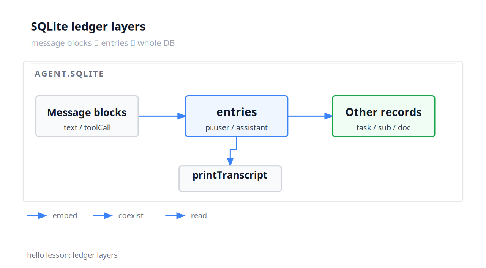
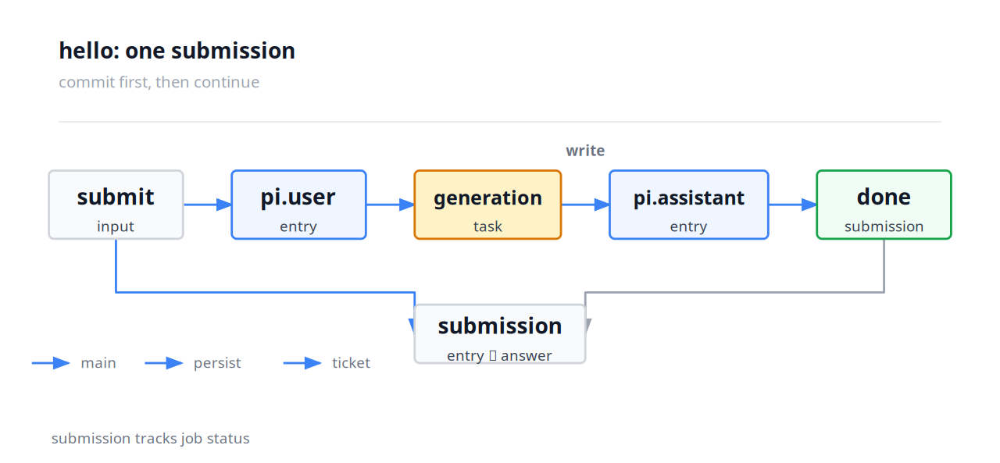
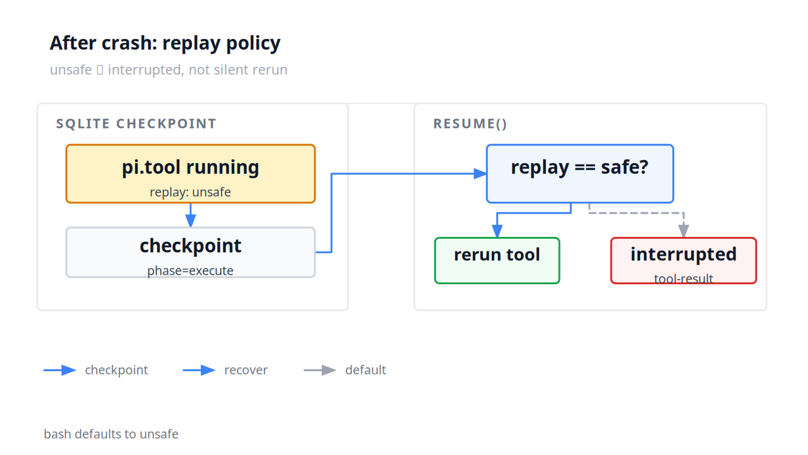
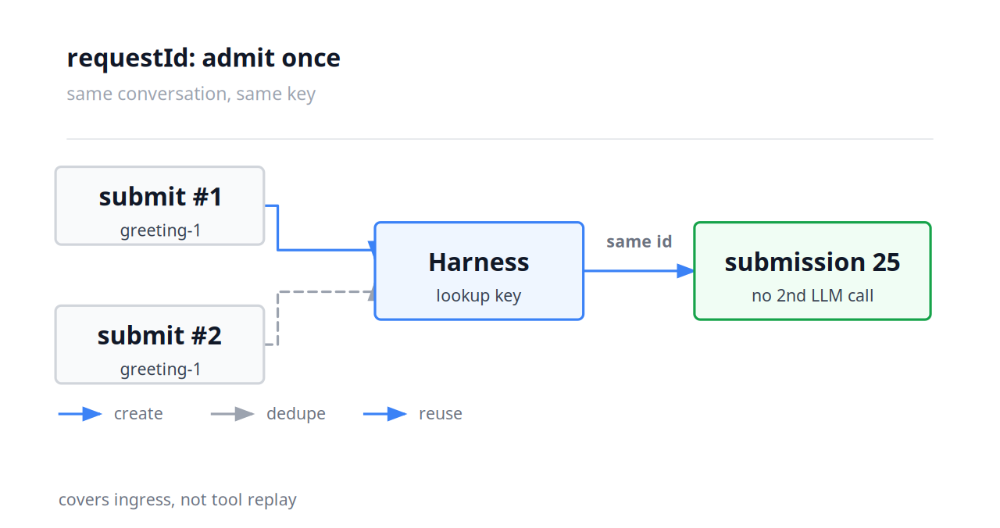
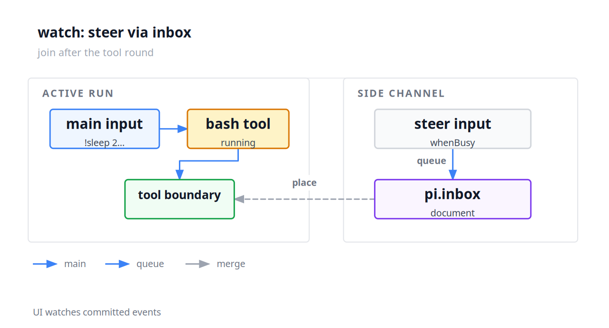

上一篇 [《Pi Durable：持续可恢复》](/posts/2026-11/pi-durable) 偏概念与 Cloudflare 实践。本文跟着官方最小教程仓库 [pi-durable-hello](https://github.com/avparkhi/pi-durable-hello)，把五课跑一遍，把库里真正落下的东西拆开。

默认用免费 **faux** 模型（普通文本回声；以 `!` 开头则发起一次 `bash`）。重点不在模型聪不聪明，而在 **每一步先 commit 再继续**。

---

## 1. 先改掉两个常见误解

### 误解 A：Pi Durable = 把本地 Pi 搬上云

更准确的说法是：它是一套 **可嵌入任意应用的 durable agent harness**——storage + 并行 conversation + tools + execution environment。你自己 `Harness.open(...)`，自己选存储与暴露面；它不是托管 SaaS，也不取代终端里的 Pi coding agent。

### 误解 B：持久化 = 存几种聊天消息

很多人直觉里的 agent 状态只有：

`user` · `assistant` · `tool_call` · `tool_output` · `thinking`

在 Pi Durable 里，这些更接近 **发给模型的消息形态**。真正写入 `.data/agent.sqlite` 的是一整套 runtime 账本：

```text
消息角色 / content 块  ⊆  entries  ⊆  整个 SQLite 世界
```



同一句口诀值得先记住：

> **同一个 `agent.sqlite` = 同一个对话世界。进程可以死；文件还在，世界就还在。**

---

## 2. 账本里到底有什么

打开 `agent.sqlite`，主要是这些表（hello 跑完就能看见）：

| 表 | 存什么 |
|---|---|
| `conversations` | 对话线程（可多条、可 fork） |
| `entries` | transcript 的不可变记录 |
| `submissions` | 你交进去的一单工作的回执 |
| `tasks` | 带 checkpoint 的状态机（generation / tool / compaction…） |
| `documents` + `document_revisions` | 可变状态及其版本 |
| `record_ids` / `durable_metadata` | 全局 ID 与 commit 序号 |

`printTranscript` **只打印 entries**。所以你看到 `#7 → #10 → #11` 编号跳号：中间夹着 submission、task、document 等非 entry 记录。

### 2.1 Entries：顶层分类 ≠ OpenAI 消息类型

内置 entry kind：

| kind | 含义 |
|---|---|
| `pi.user` | 用户输入 |
| `pi.assistant` | 模型整次回复 |
| `pi.system` | 系统提示 / 工具列表变更快照 |
| `pi.tool-result` | 工具结果 |
| `pi.reset` | 开新上下文 |
| `pi.compaction` | 压缩摘要 |

`toolCall` / `thinking` 通常是 **`pi.assistant` 的 content 块**，不是独立顶层 kind。工具结果才单独成 `pi.tool-result`。

`pi.system` 打印时常像空白：`content` 往往是空字符串，有料的是 `toolsAdded` 等变更；设定没变的后续轮次可以不再写新的 system，有利于 prompt cache。

### 2.2 Tasks：可恢复的执行单元

常见内置 task：

- `pi.generation`：调模型，写出 `pi.assistant`
- `pi.tool`：执行某个 tool call
- `pi.compaction`：压缩上下文

状态沿 `pending → running → waiting → completing → terminal` 推进。崩溃后 `harness.resume()`，就是从未完成 task 的 checkpoint 接着走。

### 2.3 Documents：不只是运行配置

Document = 挂在 conversation（或 task / session）上的 **可变状态**；Revision = 内容版本（`base` / `delta`）。

hello 里已经有的内置文档：

| kind | 作用 |
|---|---|
| `pi.agent` | 模型、`cwd`、工具子集等配置（可 rewind） |
| `pi.provider` | provider session 信息 |
| `pi.usage` | token / 费用累计 |
| `pi.inbox` | 待处理输入队列（steer 会用到） |
| `pi.live` | 当前流式 / 工具槽位等实时视图 |

业务上的 todo / ticket / plan 也可以做成 document，与 transcript **同一事务提交**——UI 应订阅 committed document，而不是另维护一份私有真相。

### 2.4 Submission：作业单，不是消息本身

用快递单类比最省事：

> **entries** 是「写下了什么」；**submission** 是「这单活办到哪了」。

一次 `root.submit({ type: "input", content })` 会关联：

- `entry` → 对应的 `pi.user`
- 跑完后的 `answer` → 某条 `pi.assistant`
- 状态：`queued → placed → done | unanswered`

它让三件事变得自然：跨进程 `wait`、用 `requestId` 做入口幂等、把「消息已落盘」和「这单算完成」拆开。

### 2.5 `root` 是什么

`harness.root()` 拿到的不是「agent 说的第一句话」，而是这个 SQLite 世界里 **预留的主 conversation（固定 id = 1）**：稳定的默认入口。一个文件里还可以有更多 conversation（fork / 子 agent）；产品侧通常自己映射 `session → conversationId`。

---

## 3. 五课：从输出反推机制

本地按顺序跑（可先 `npm run clean` 清空 `.data/`）：

```bash
npm run hello && npm run hello
npm run crash && npm run resume
npm run twice
npm run watch
```

### Lesson 1：`hello` —— 一问一答已经在磁盘上

```text
submission 8 is done
  #7   pi.user         What is a durable agent?
  #10  pi.system
  #11  pi.assistant    Echo: What is a durable agent?
```

脚本几乎只有：打开 harness → `submit` → `wait` → 打印 transcript → `close`。



流水线概念上是：

```text
submit
  → pi.user
  → pi.generation task
  → pi.system（如有工具/设定变更）
  → pi.assistant
  → submission done
```

再跑一次 `hello`（不 clean）：

```text
submission 13 is done
  #7 / #10 / #11     ← 上一轮还在
  #12 pi.user
  #15 pi.assistant   ← 本轮追加；通常不再写新的 pi.system
```

**脚本每次都是新进程；对话不是。** 没有 `requestId` 时，相同文案也会变成新的一轮。

### Lesson 2：`crash` —— 杀进程 ≠ 丢工作

```ts
await root.submit({
  type: "input",
  content: "!sleep 4 && echo FINISHED",
  requestId: "crash-demo-1",
}, ctx);
// 1.5s 后 process.exit(1) —— 不 close、不 cleanup
```

faux 见到 `!` 会发起 `bash`。工具要跑 4 秒，1.5 秒硬杀。终端只看到「submitted / Killing…」，但库里已经有：

| 对象 | 崩溃现场 |
|---|---|
| `#16 pi.user` | 输入已落盘 |
| `#19 pi.assistant` | `stopReason: toolUse`，带 `toolCall` |
| submission | **`placed`**（还没有 `answer`） |
| generation task | **`waiting`**（等 tool） |
| tool task | **`running`**，checkpoint 含 `phase: execute` 与 `replay` |

「进行中」本身也是持久状态。正常 `close()` 不是 durability 的前提——因为每步先 commit。

### `replay: "unsafe"` 是什么、何时写入、为什么

这是 **工具的崩溃恢复策略**，不是 bash 参数。

注册 tool 时可声明 `replay?: "safe" | "unsafe"`，**默认 `unsafe`**。`pi.tool` 在真正执行前会把意图 commit 进 checkpoint：

```text
{ phase: "execute", arguments: {...}, replay: tool.replay ?? "unsafe" }
```



恢复时：

- 两边都是 `safe` → 允许用同样参数再跑
- 否则 → **不重跑**，写入 interrupted 的 `pi.tool-result`，让模型看见真相

`bash` 有副作用（可能已删文件、打过外部请求），所以必须默认 unsafe。Durable 的诚实边界是：**checkpointed，不是 exactly-once**；外部副作用仍要自带幂等键。

### Lesson 3：`resume` —— 新进程捡起旧单

```ts
harness.resume();
const submission = await harness.submission(id, ctx); // crash 留下的 17
await submission.wait(ctx);
```

恢复链路：

```text
发现 tool 未完成且 replay=unsafe
  → #21 pi.tool-result（interrupted，带 <harness> 诊断）
  → tool task failed
  → 新的 generation
  → #23 pi.assistant（faux：Tool finished: … interrupted …）
  → submission 17 → done（answer=#23）
```

容易说滑的一句：「agent 会谨慎重试」。更准确是：

> **Harness 知道停在哪、对 unsafe 工具不盲目重放；要不要重试，是模型读完 interrupted 结果后的决策。**  
> faux 只会机械回声；换成真模型，「谨慎重试」才可能发生。

### Lesson 4：`twice` —— `requestId` 管入口，不管工具重放

```text
first.id=25  second.id=25  same=true
status: done
```



同一 conversation 内，相同 `requestId` 只受理一次：不写第二条 user，不开第二次 generation。  
若第一单还在跑，第二次返回的是**同一单**，你是在等那次飞行中的工作，不是并行再开一枪。

和第二次 `hello` 对比：文案相同但没有 `requestId` → 两轮并存。

| | `requestId` | `replay` |
|---|---|---|
| 管什么 | 这句输入算不算新单 | 崩溃后 tool 能不能重跑 |

### Lesson 5：`watch` —— UI 只是 committed 状态的观察者

```ts
const stream = await watchEvents(harness, root.id, ctx);
// snapshot: N entries already stored
root.submit({ content: "!sleep 2 && echo first" });
root.submit({ content: "Also say thanks.", whenBusy: "steer" });
```



- 先拿到 **snapshot**（晚加入不重放全部历史事件）
- 主任务带着 bash 跑时，steer 先进入 **`pi.inbox`**（事件里有 `inbox_update`）
- 当前 tool 轮次结束后再 place 成 `pi.user`，参与后续 generation
- 你看到的 `run_*` / `turn_*` / `tool_execution_*` / `submission` 都是 **commit 之后** 发出的事件

Web UI / 终端 UI 用的是同一类流：订阅真相，而不是私有缓存。

---

## 4. 五课分别钉住什么

1. **hello** —— commit-first 与跨进程 transcript  
2. **crash** —— 进行中状态也落盘  
3. **resume** —— checkpoint + replay 策略  
4. **twice** —— 入口 exactly-once  
5. **watch** —— 多端订阅与 steer / inbox  

（刻意不做一张「全家福」总图；上面各课的局部图已经够用。）

---

## 5. 和「做成服务」怎么接上

hello 仓库刻意没有 HTTP。对照上一篇与 Durable Pi 一类后端，映射大致是：

| 这里 | 服务里 |
|---|---|
| 一个 sqlite 文件 | 一台机器 / 一个 session 一份存储 |
| `root.submit` + `requestId` | `POST .../messages` |
| `watchEvents` | SSE / WebSocket 推 snapshot + deltas |
| `harness.resume` | 进程或 Durable Object 醒来后续跑 |
| steer | 产品上的「插入指令」按钮 |

三个自然长出来的模式：主动触发的 agent、多客户端附着同一会话、人在回路里的长时间等待——都依赖同一套账本，而不是「聊天框偶发能 resume」。

---

## 6. 边界（初稿也先写清）

- Pi Durable 仍是 **experimental**，API 可能变；hello 仓库会钉版本。  
- Durable ≠ exactly-once；`replay: unsafe` 与外部幂等键要一起设计。  
- 一个进程占有一个 storage 文件；没有跨进程文件锁。  
- `bash` 等工具权限等于跑进程的用户权限。

---

## 参考

- 教程仓库：[avparkhi/pi-durable-hello](https://github.com/avparkhi/pi-durable-hello)
- Earendil：[Pi Durable](https://earendil.com/posts/pi-durable/)
- 概念与 Cloudflare 实践：[《Pi Durable：持续可恢复》](/posts/2026-11/pi-durable)
- Cloudflare：[Agents · Pi harness](https://developers.cloudflare.com/agents/harnesses/pi/)

**一句话收束：** 先别急着聊「agent 多聪明」；把 sqlite 里的 entry / task / submission / document 读顺，你才知道 durable harness 到底 durable 在哪。
