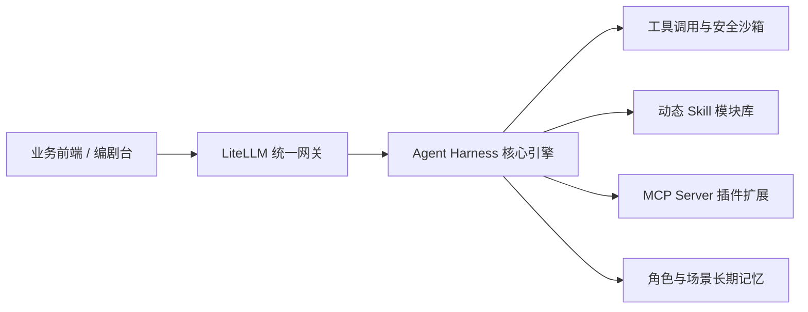

## Harness 核心定位

在复杂的生成业务中，不能仅仅依赖零散的 Prompt 拼接。Agent Harness 作为业务中台的“动力骨骼”，承担着环境感知、工具编排、状态维护与模型调度的核心职责。

---

## 核心设计特性

### 1. 工具调用与安全沙箱
- 严格遵循参数 Schema 校验，拦截非法或畸形输入。
- 敏感操作实施人机协同（Human-in-the-Loop）确认机制，保证生成流程不失控。

### 2. Skill 版本控制与动态加载
- 将不同漫剧类型（修仙、悬疑、科幻、恋爱）的分镜写作风格封装为独立 Skill。
- 支持团队根据不同作品定制 Skill，运行时动态热插拔与版本灰度。

### 3. MCP（Model Context Protocol）扩展
- 接入标准化 MCP 协议，通过 MCP Client 连接外部多模态服务（如语音合成、自动画质增强、外部数字人引擎）。
- 解耦核心 Harness 与外部工具，提供即插即用的微服务协同。

### 4. 角色与视觉一致性记忆
- 构建结构化实体知识图谱：记录主角的外貌特征、服饰演进、专属武器与常用姿态。
- 在跨分镜、跨分集生成时自动提取特征嵌入（Embedding / Prompt 约束），杜绝角色严重“变脸”。
