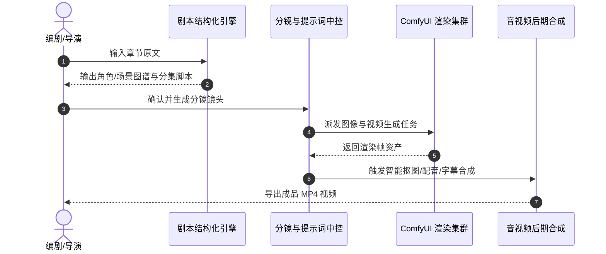

## 生产流水线全貌

AI 漫剧从小说原著到成片输出经历五个标准工序阶段：

---

## 各阶段技术实践

### 1. 剧本结构化与实体提取
- 利用 LLM 解析原文对话与环境描写，抽离角色情绪状态、时间空间坐标与道具变更。
- 自动生成标准化分场表，指导后续分镜分配。

### 2. 镜头语言与提示词映射
- 将文学语言转化为影视分镜描述（景别：特写/全景；视角：俯视/仰视；光影氛围）。
- 结合角色 LoRA 触发词与负向提示词模板，自动构造 ComfyUI API 适配的参数包。

### 3. 多模态渲染与批量处理
- 调度 ComfyUI 工作流实现多通道渲染：基础画面生成 -> IP-Adapter 角色面部特征迁移 -> ControlNet 姿态对齐。
- 支持失败重试、批次并发调优与显卡集群负载均衡。

### 4. 智能后期处理与字幕对齐
- **字幕擦除与重建**：针对参考画面中的硬字幕采用轻量修复模型自动擦除。
- **语音合成与对口型**：基于角色人设自动匹配 TTS 声音音色，利用声学特征对齐分镜口型与字幕轴。
