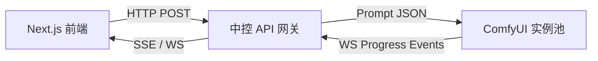

## 为什么需要 API 封装？

原生 ComfyUI 提供了极具弹性的可视化连线界面，但在工业化工程与多用户 Web 应用中存在天然局限：缺少用户鉴权、并发队列管理弱、无法精细控制前端进度反馈。

本项目搭建了轻量级中间层网关（FastAPI + WebSocket）：

---

## 核心工程技术实现

### 1. 工作流 JSON 动态参数注入
- 将导出为 API 格式的 ComfyUI 工作流作为基础模板。
- 在网关层暴露精炼参数（Prompt、Negative Prompt、Seed、Steps、CFG、LoRA Weight），自动定位目标节点并完成参数热替换。

### 2. 双向 WebSocket 进度追踪
- 监听 ComfyUI 底层 `executing` 与 `progress` 事件。
- 向上层客户端推送毫秒级步数进度（如 `K-Sampler: step 12/25`）与潜空间预览图（Preview Image），极大提升交互即时感。

### 3. 错误恢复与超时容灾
- 针对显卡 OOM（Out of Memory）或网络超时的偶发故障，网关自动捕获异常日志并实施指数退避重试。
- 维护健康度自检探针，自动将请求分流至健康 GPU 实例。
