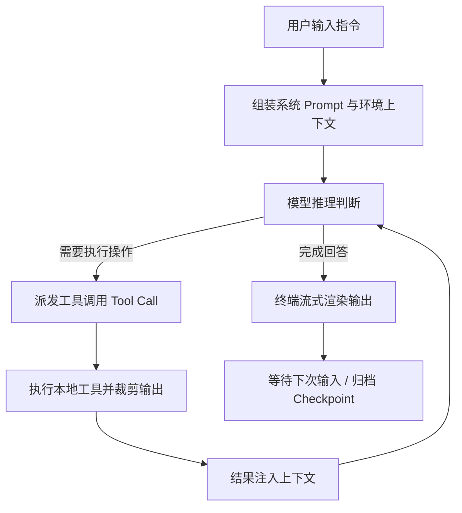

## 核心 Agent Loop

Agent 的本质是一个由 LLM 驱动的感知-决策-行动控制循环。在本项目中，Agent Loop 采用单步明确、状态受控的状态机架构：

### 关键环节解析

- **Prompt 组装**：每次循环前自动注入当前工作目录、Git 分支状态、已激活 Skill 列表以及精简版目录结构，确保模型拥有明确的环境感知。
- **工具调用拦截**：解析模型输出的 `tool_calls`，校验参数合法性并在沙箱或本地安全边界内执行。
- **反馈注入**：标准化工具返回值，并将结构化结果写回对话上下文，供下一轮推理反思。

---

## 上下文动态压缩机制

在长会话与多步编码任务中，上下文很容易逼近模型的 Token 上限。本项目设计了**双阈值动态压缩策略**：

1. **预警阈值（80% 窗口）**：自动折叠已执行完毕的中间工具输出，仅保留工具签名与关键结果摘要。
2. **临界阈值（95% 窗口）**：触发深度压缩流程，由轻量辅助模型将之前的对话历史浓缩为结构化事实表（Goals, Completed, Current State），重建精炼的记忆上下文。

---

## 终端流式响应（Streaming）

基于 OpenAI Agents SDK 的 `Runner.run_stream` 事件流，实现高响应度的终端交互：

- **Thinking 阶段**：流式展示思考过程动画与正在调用的工具名称。
- **Execution 阶段**：实时展示工具执行进度条（如文件扫描、网络检索）。
- **Output 阶段**：逐字符流式高亮 Markdown 与代码块，告别长时间空白等待。
