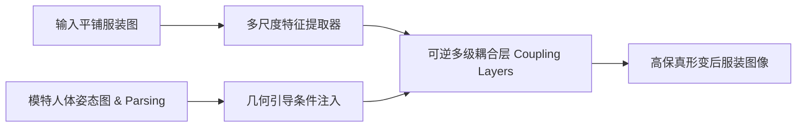

## 传统几何变形的瓶颈

在虚拟试衣第一阶段，必须将平铺的服装图变换为符合模特姿态的人体穿着轮廓：

- **TPS（Thin-Plate Spline）**：对控制点数量与分布极度敏感，容易在大动作（如双手叉腰、侧身）时发生翻折与局部自相交。
- **外观流（Appearance Flow）**：不可逆且缺乏拓扑约束，高频细节极易丢失，造成衣领、口袋和纽扣模糊扭曲。

---

## 归一化流（Normalizing Flow）解法

本项目提出了一种基于连续条件归一化流的服装变形估计网络（Clothing Normalizing Flow Network）：

### 核心改进要点

1. **可逆保拓扑性**：利用可逆雅可比矩阵（Invertible Jacobian）与双射映射特性，确保服装各个区域在形变过程中不会出现不合理的撕裂与信息坍缩。
2. **多尺度跨层级注意力**：在粗粒度层级预测主体位姿走向，在细粒度层级聚焦纽扣、缝线等微观纹理对齐。
3. **几何正则化损失**：引入二阶刚性先验损失函数，有效抑制不符合真实织物物理特性的过度剪切与非自然拉伸。
